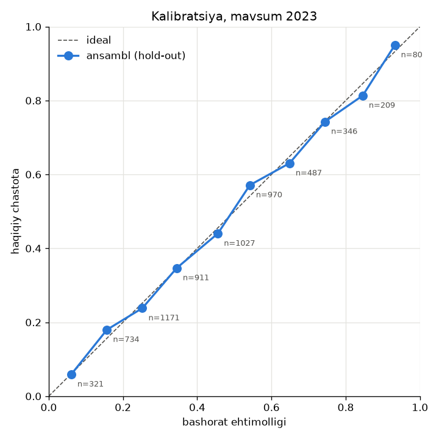
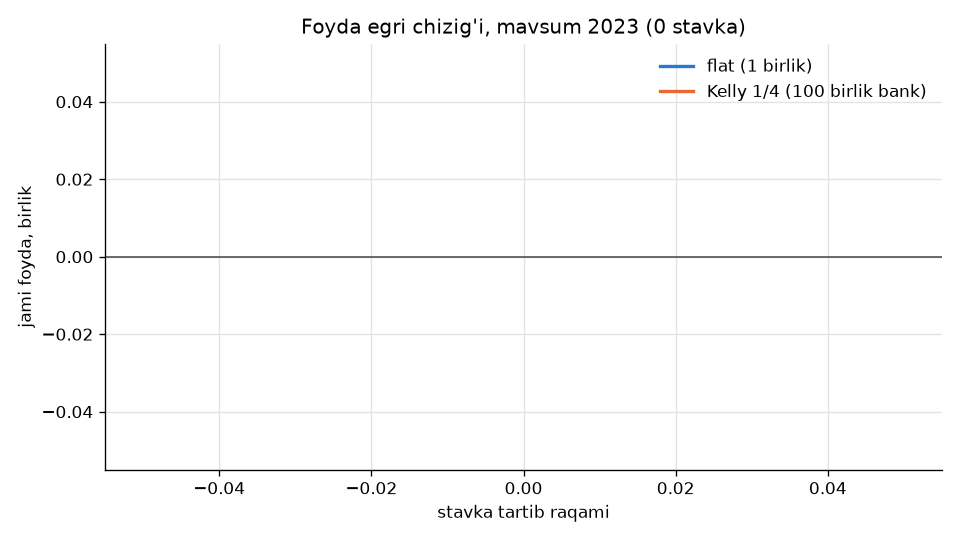

# Backtest hisoboti: synthetic

> Bu **sintetik** ma'lumotdagi backtest: bozor ta'rifiga ko'ra samarali (narx = haqiqiy ehtimollik + marja), shuning uchun kutilgan natija ROI ~ -marja va ahamiyatli ustunlik yo'qligi. U backtest vositasini tekshiradi, modelni emas. **Haqiqiy ma'lumotdagi F3 darvozasi hali kutilmoqda** (qarorlar jurnali #7: football-data.co.uk bu mashinada bloklangan; serverda `scripts/import_history.py` + `scripts/backtest.py` bilan bajariladi).
> Sanity tekshiruvi (samarali bozor): validatsiya sof bozorni (w = 0) tanladi va hold-out da stavka qo'yilmadi — samarali bozorda kutilgan to'g'ri natija (DC bozorga ma'lumot qo'shmaydi, bozor narxida EV doim manfiy).

- **Rejim:** sintetik
- **Sana:** 2026-10-21T10:46:47+00:00
- **F3 darvozasi (shu ma'lumotda):** ❌ bajarilmadi

## Qayta olinadiganlik

| Parametr | Qiymat |
|---|---|
| Git commit | `19607df74cb185b6d95ae338c1bb1cd0c19ba9b0` |
| Ma'lumot izi (SHA-256) | `64a643c158179830f5b4170e7ae806e66ab89ab18d39736d9e41b409e436c5c9` |
| Seed (bootstrap) | `20261021` |
| O'yinlar (tugagan) | 5700 |
| Ligalar | Synthetic League 0, Synthetic League 1, Synthetic League 2 |
| Mavsumlar | 2019, 2020, 2021, 2022, 2023 |
| Refit oralig'i | 7 kun |
| Tarix oynasi | 1100 kun |
| Koeffitsient oralig'i | 1.50-3.00 |
| Bootstrap qayta tanlashlar | 2000 |
| synthetic.leagues | `3` |
| synthetic.teams_per_league | `20` |
| synthetic.seasons | `5` |
| synthetic.first_season | `2019` |
| synthetic.seed | `20261021` |
| synthetic.intercept | `0.15` |
| synthetic.home_advantage | `0.25` |
| synthetic.rho | `-0.08` |
| synthetic.strength_sd | `0.3` |
| synthetic.season_drift_sd | `0.1` |
| synthetic.match_shock_sd | `0.15` |
| synthetic.bookmakers | `pinnacle/opening/3.0%, pinnacle/closing/2.5%, market_avg/opening/5.5%, market_avg/closing/5.0%` |

## Metodologiya

- **Walk-forward:** har bir o'yin o'z ligasining `as_of` dan **qat'iy oldingi** o'yinlari bilan fit qilingan Dixon-Coles modeli bilan bashorat qilinadi (`as_of` = refit sanasi <= o'yin sanasi; sana = UTC kickoff sanasi). Fitga `as_of` yoki undan keyingi o'yin kirsa model xato beradi; testda har bir fit tekshiriladi.
- **Bo'linish:** train (faqat tarix) 2019, 2020, 2021 · validatsiya 2022 · hold-out 2023 (bir marta).
- **Stavka narxi:** `pinnacle` **opening**. **CLV** va bozor bazasi: `pinnacle` **closing** (de-vig: shin). Darvozadagi 'yopilishdagi ROI' o'sha stavkalarni yopilish narxida qayta hisoblaydi.
- **Bozor modeli:** ustuvor pinnacle, zaxira market_avg; bashorat vaqtida faqat **opening** narxlari ishlatiladi.
- **Ansambl:** `p = w * p_DC + (1 - w) * p_bozor` (to'liq natija taqsimoti bo'yicha); har o'yindan EV bo'yicha eng yaxshi **bitta** stavka.
- **Stavka hajmi:** flat 1 birlik va Kelly x 0.25 (maks. 2%) 100 birlik **o'zgarmas** bankdan.
- **Baholash:** log-loss va Brier (bozor bazasi = de-vig qilingan yopilish), kalibratsiya, ROI/CLV uchun bootstrap 95% CI (seed bilan).

## Parametr tanlash (validatsiya 2022)

- Sinalgan konfiguratsiyalar soni: **180** (xi x w x min EV x min ehtimollik). Eng yaxshi validatsiya ROI si ko'p sinov (multiple testing) sababli **optimistik**; haqiqiy baho - hold-out.
- 1-bosqich: `(xi, w)` validatsiya log-loss bo'yicha; 2-bosqich: chegaralar ROI bo'yicha (>= 50 signal).
- **Tanlangan:** xi = 0, w = 0, min EV = +0.00%, min ehtimollik = 30.0%.
- ⚠️ Chegaraviy w = 0 tanlandi (grid chekkasi): sof bozor modeli eng yaxshi; DC qo'shimcha ma'lumot bermadi.
- ⚠️ Hech bir chegara validatsiyada >= 50 signal bermadi: eng ko'p signalli konfiguratsiya tanlandi.

Validatsiya ROI bo'yicha eng yaxshi 10 ta qator:

| xi | w | min EV | min p | signallar | ROI | log-loss (ansambl) |
|---|---|---|---|---|---|---|
| 0.0019 | 0.25 | +8.00% | 30.0% | 94 | +14.01% | 0.7678 |
| 0 | 0.25 | +8.00% | 30.0% | 109 | +9.39% | 0.7681 |
| 0 | 0.25 | +5.00% | 30.0% | 291 | +7.58% | 0.7681 |
| 0.0019 | 0.25 | +5.00% | 30.0% | 277 | +7.56% | 0.7678 |
| 0 | 0.25 | +5.00% | 55.0% | 110 | +4.05% | 0.7681 |
| 0 | 0.25 | +5.00% | 45.0% | 216 | +3.18% | 0.7681 |
| 0 | 0.75 | +8.00% | 45.0% | 669 | +2.70% | 0.7819 |
| 0 | 0.75 | +8.00% | 30.0% | 750 | +2.09% | 0.7819 |
| 0 | 0.25 | +0.00% | 30.0% | 864 | +2.07% | 0.7681 |
| 0 | 1 | +8.00% | 45.0% | 800 | +1.66% | 0.7943 |

## Hold-out natijasi (bir marta baholandi): mavsum 2023

Bashoratlar: 1140 · o'tkazib yuborilgan: yo'q · fitlar: 114 (muvaffaqiyatsiz: 0)

| Ko'rsatkich | Qiymat |
|---|---|
| Signallar | 0 |
| ROI / yield (flat) | +0.00%  |
| Foyda (flat, birlik) | +0.00 |
| Hit rate (foyda bilan yopilgan) | 0.0% |
| Maksimal pasayish (flat, birlik) | 0.00 |
| ROI yopilish narxida (0 ta) | -  |
| CLV: o'rtacha log(odds / yopilish adolatli) (0 ta) | -  |
| Yopilish narxi bor stavkalar (CLV qamrovi) | 0 / 0 |
| Yopilishsiz stavkalar ROI, olingan narxda (0 ta) | - |
| Yopilishni yutgan ulush | - |
| Yopilish taqsimotida kutilgan EV | - |
| Kelly 1/4: ROI · bank daromadi · maks. pasayish | +0.00% · +0.00% · 0.00 |

**Proper scoring (bozor nusxasiga o'rtacha; kichik = yaxshi):**

| Guruh | n | log-loss ansambl | log-loss DC | log-loss bozor (yopilish) | Brier ansambl | Brier DC | Brier bozor |
|---|---|---|---|---|---|---|---|
| 1x2 | 1132 | 0.9274 | 0.9487 | 0.9273 | 0.5488 | 0.5619 | 0.5487 |
| asian_handicap (x.5) | 294 | 0.6917 | 0.7319 | 0.6918 | 0.4986 | 0.5349 | 0.4987 |
| totals 2.5 | 1136 | 0.6097 | 0.6325 | 0.6097 | 0.4233 | 0.4419 | 0.4232 |
| all | 2562 | 0.7595 | 0.7836 | 0.7594 | 0.4874 | 0.5056 | 0.4873 |

**Kalibratsiya (ansambl):**

| Oraliq | n | o'rtacha bashorat | haqiqiy chastota | og'ish |
|---|---|---|---|---|
| 0%-10% | 321 | 6.1% | 5.9% | -0.2 p.p. |
| 10%-20% | 734 | 15.7% | 18.0% | +2.3 p.p. |
| 20%-30% | 1171 | 25.2% | 23.8% | -1.4 p.p. |
| 30%-40% | 911 | 34.5% | 34.7% | +0.2 p.p. |
| 40%-50% | 1027 | 45.5% | 44.0% | -1.5 p.p. |
| 50%-60% | 970 | 54.2% | 57.1% | +2.9 p.p. |
| 60%-70% | 487 | 64.9% | 63.0% | -1.8 p.p. |
| 70%-80% | 346 | 74.4% | 74.3% | -0.1 p.p. |
| 80%-90% | 209 | 84.6% | 81.3% | -3.2 p.p. |
| 90%-100% | 80 | 93.2% | 95.0% | +1.8 p.p. |

**Liga kesimi:**

_signal yo'q_

**Bozor kesimi:**

_signal yo'q_

## Validatsiya (tanlangan konfiguratsiya, optimistik): mavsum 2022

Bashoratlar: 1140 · o'tkazib yuborilgan: yo'q · fitlar: 114 (muvaffaqiyatsiz: 0)

| Ko'rsatkich | Qiymat |
|---|---|
| Signallar | 0 |
| ROI / yield (flat) | +0.00%  |
| Foyda (flat, birlik) | +0.00 |
| Hit rate (foyda bilan yopilgan) | 0.0% |
| Maksimal pasayish (flat, birlik) | 0.00 |
| ROI yopilish narxida (0 ta) | -  |
| CLV: o'rtacha log(odds / yopilish adolatli) (0 ta) | -  |
| Yopilish narxi bor stavkalar (CLV qamrovi) | 0 / 0 |
| Yopilishsiz stavkalar ROI, olingan narxda (0 ta) | - |
| Yopilishni yutgan ulush | - |
| Yopilish taqsimotida kutilgan EV | - |
| Kelly 1/4: ROI · bank daromadi · maks. pasayish | +0.00% · +0.00% · 0.00 |

**Proper scoring (bozor nusxasiga o'rtacha; kichik = yaxshi):**

| Guruh | n | log-loss ansambl | log-loss DC | log-loss bozor (yopilish) | Brier ansambl | Brier DC | Brier bozor |
|---|---|---|---|---|---|---|---|
| 1x2 | 1139 | 0.9275 | 0.9501 | 0.9275 | 0.5497 | 0.5648 | 0.5497 |
| asian_handicap (x.5) | 283 | 0.6888 | 0.7153 | 0.6888 | 0.4956 | 0.5194 | 0.4957 |
| totals 2.5 | 1140 | 0.6244 | 0.6581 | 0.6245 | 0.4367 | 0.4653 | 0.4368 |
| all | 2562 | 0.7663 | 0.7943 | 0.7663 | 0.4935 | 0.5155 | 0.4935 |

**Kalibratsiya (ansambl):**

| Oraliq | n | o'rtacha bashorat | haqiqiy chastota | og'ish |
|---|---|---|---|---|
| 0%-10% | 241 | 6.3% | 5.4% | -0.9 p.p. |
| 10%-20% | 691 | 15.7% | 14.6% | -1.1 p.p. |
| 20%-30% | 1249 | 25.1% | 25.5% | +0.4 p.p. |
| 30%-40% | 991 | 34.6% | 35.3% | +0.7 p.p. |
| 40%-50% | 1035 | 45.7% | 47.3% | +1.6 p.p. |
| 50%-60% | 950 | 54.1% | 50.9% | -3.1 p.p. |
| 60%-70% | 556 | 64.7% | 66.4% | +1.7 p.p. |
| 70%-80% | 327 | 74.5% | 74.9% | +0.4 p.p. |
| 80%-90% | 177 | 84.2% | 81.9% | -2.3 p.p. |
| 90%-100% | 46 | 93.5% | 100.0% | +6.5 p.p. |

**Liga kesimi:**

_signal yo'q_

**Bozor kesimi:**

_signal yo'q_

## Grafiklar

## F3 darvozasi (hold-out, qaror #11)

| Mezon | Nuqta bahosi | 95% CI | n | Holat | Izoh |
|---|---|---|---|---|---|
| Kalibratsiya: har 10% oraliqda (n >= 30) og'ish <= 5 p.p. | eng katta 3.2 p.p. | - | 10 oraliq / 6256 bashorat | ✅ | ansambl, partition bozorlar |
| >= 500 signal; CLV o'rtachasi > 0 va 95% CI pastki chegarasi > 0 | - | - | 0 / 0 | ❌ | faqat yopilish narxi bor stavkalar; signal kam (< 500) |
| ROI: nuqta >= 0% va 95% CI pastki chegarasi >= -2.00% | - | - | 0 | ❌ | flat, olingan koeffitsientda |
| Kamida 3 ta ligada (har biri n >= 100) CLV > 0 | 0 liga | - | 0 / 0 liga n >= 100 | ❌ | - |
| Sof bozor (w = 0) bazaviy varianti bilan solishtirish (log-loss) | 0.7595 vs 0.7595 | - | hold-out partition bozorlar | ❌ | w = 0 tanlandi: DC bozorga ma'lumot qo'shmaydi |

Darvoza faqat barcha mezonlar ✅ bo'lsa o'tadi. 'ahamiyatsiz' = nuqta bahosi bajarilgan, lekin 95% CI bajarilmagan (qarorlar jurnali #11): ✅ hisoblanmaydi.
